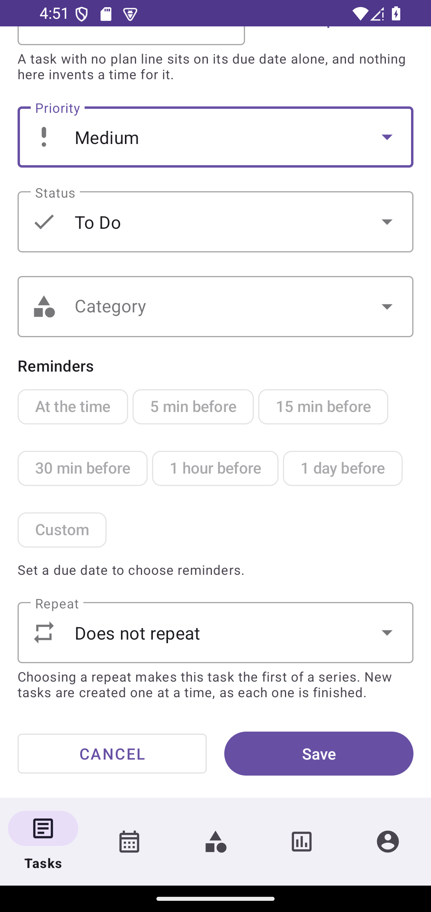
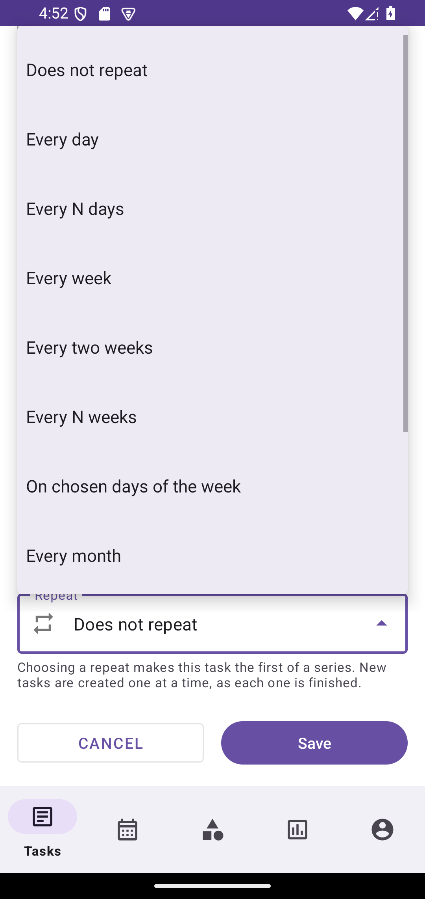
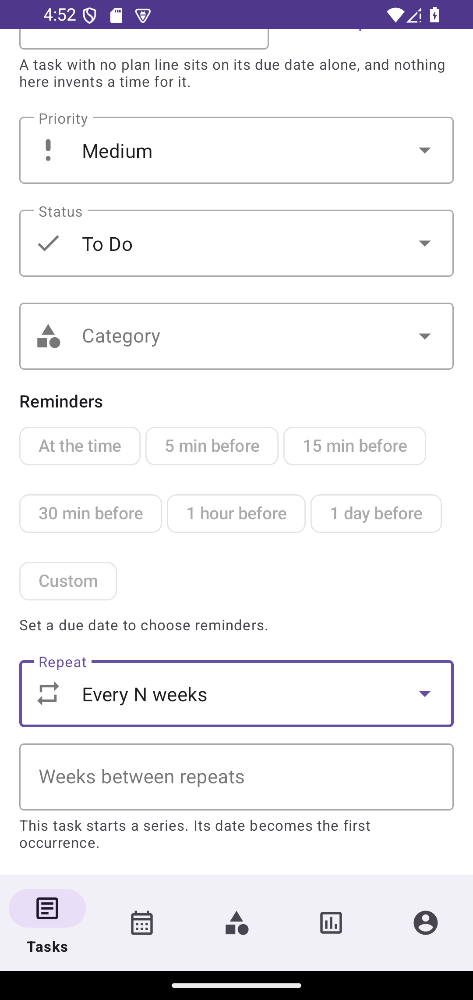
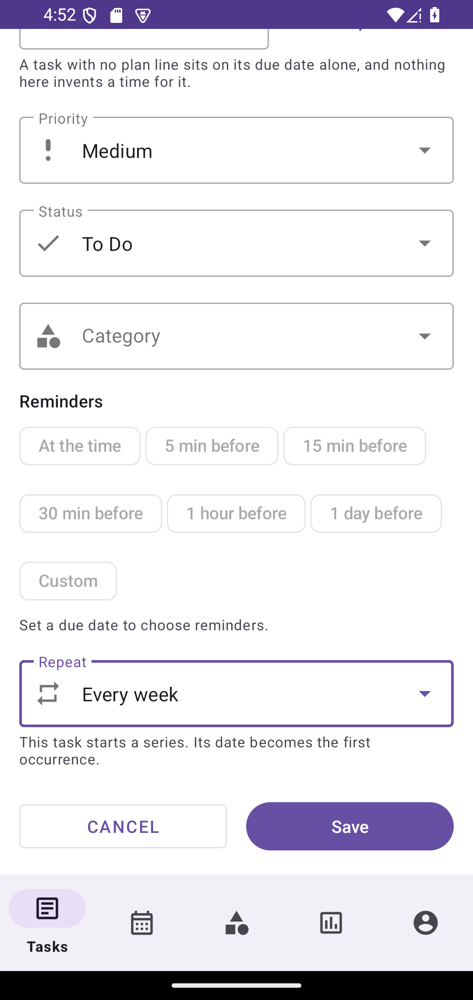

# Task Planner

Offline-first task manager for Android. Tasks, categories, topic groups, an archive and a lifecycle
(`TODO → IN_PROGRESS → PAUSED → DONE`), repeating tasks with series management, deadline reminders
that survive a reboot, and optional Google sign-in with cloud sync that never has to be used for the app
to work — **no build of this repository has a Firebase project, so every build of it is local-only**
(see *Known limitations* below and `docs/FIREBASE_SETUP.md`).

## Build and test

Requirements: JDK 17, Android SDK 34. The Gradle wrapper pins everything else.

```
./gradlew assembleDebug        # build the debug APK
./gradlew testDebugUnitTest    # 1637 JVM tests (Robolectric + real Room + real SQLite migrations)
./gradlew lintDebug            # Android Lint
./gradlew assembleDebugAndroidTest   # compile the on-device tests
./gradlew connectedDebugAndroidTest  # run them — needs a device or emulator
```

Firebase is optional. The app builds and runs without `google-services.json`: cloud features stay
disabled and everything is stored locally (see `docs/FIREBASE_SETUP.md`).

## Where your data lives

The database is `taskplanner.db`, opened through Room's default private location
`/data/data/com.taskplanner/databases/`. Android may clear a cache directory at any time, and
earlier builds kept the database in `cacheDir`, which is where the lost-tasks reports came from.

On first start `LegacyDbRescuer` looks for a database in the old locations (`cacheDir`,
`externalFilesDir`, `filesDir`), scores every copy it finds by how many rows it holds and how
recently it was updated, and copies the richest one — together with its `-wal` and `-shm` sidecars —
into the permanent location. Nothing is deleted: the legacy files stay where they were.

Migrations run for every retained schema version (1 → 12) and are covered by tests that execute the
production `Migration` objects against real SQLite files built from the exported schema JSON. There
is deliberately **no** `fallbackToDestructiveMigration()`: if the app meets a schema it does not
know, it refuses to open the database and the rows stay on disk untouched, instead of the user
waking up to an empty list.

## Features

- **Tasks** with priority, due date, category, topic group, free-text search and manual ordering
  via a dedicated drag handle (long-pressing a row starts a selection instead of dragging it).
- **Topic groups** (`TaskGroup`) that collapse and expand. A topic is not a category: one task can
  sit in a topic and belong to a category at the same time.
- **Swipe right to left** on a row to slide its Edit / Delete panel open.
- **Multi-select**: long press, then a mass-action bar with select-all, delete and cancel.
- **Archive**: completing a task archives it rather than removing it; the archive has its own
  search and category filter, restores, and an explicit hard delete that really drops the row.
- **Categories** with a filter chip row on the list screen, including "no category".
- **Repeating tasks**: daily / weekly / monthly / yearly and counted variants, chosen weekdays,
  month ends and leap days included, with series pause, resume, finish and delete (see
  *Recurring tasks* below).
- **Reminders**: one or more lead times before a deadline — at the time, 5, 15, 30 or 60 minutes
  before, a day before, or any custom number of minutes — each delivered as its own notification with
  Complete, Snooze and Edit buttons, and armed as an alarm that survives a reboot, a clock change, a
  force-stop and a week with the phone switched off (see *Reminders* below).
- **Calendar**: month, week and day views over the same data, with a day's tasks coloured and counted
  by category, an overdue and overload signal per day, overlapping tasks laid side by side instead of
  hidden, and drag-and-drop that moves a task to another day, re-arms its reminders and queues the
  change for sync (see *Calendar* below).
- **Time tracking**: Start / Pause / Resume / Stop on a task, one running timer per profile enforced by
  the database rather than by the UI, and a history of every measured stretch with period filters, three
  orderings, hand-entered intervals and corrections of closed ones — the earlier account kept, conflicts
  shown instead of written over (see *Time tracking* below).
- **Backup**: versioned JSON (`1.1`) exported and imported through the Storage Access Framework, so
  the app never asks for a broad storage permission. The file carries tasks with their planned window,
  categories, topics, repeat patterns and lead times. Import previews what is in the file first, then
  either merges by stable uuid or replaces, keeping a safety copy in app-private storage before a
  replace, and puts the restored patterns and alarms back to work once the write has committed.
- **Reports**: the whole account for a chosen period, as a document. Opened from **Profile → Reports**, it
  asks one question at a time — a day, a week, a month, a year or a span of your own choosing — counted in
  the device's own timezone or in any zone you pick from a searchable list, each stated with the offset that
  zone is standing at today. The answer is previewed as the two files it can become: the pages of the PDF,
  at three sizes, or the rows of the csv exactly as the writer quotes them. **Save** opens the system's own
  document picker and says nothing about the result until the bytes are on their way; **Share** stages a copy
  this app can grant over and hands it to the app you chose — a hand-over, never a promise of delivery. No
  storage permission is asked for anywhere. The figures are the report repository's, unchanged: the screen
  counts nothing, sums nothing and fills in nothing (see `docs/REPORT_EXPORT.md`).
- **Accounts**: Google Credential Manager + Firebase Auth. The Firebase UID, never the e-mail, is
  the identity anchor. Settings shows which of the four account states the build is in — not configured,
  not signed in, linked but signed out, signed in — and on a build with no project the sign-in row is
  **visible and disabled with the reason beside it**, not hidden. Signing out ends the cloud session and
  leaves the reader on their own profile with their data reachable. A local profile can be moved onto a
  Google account explicitly, from Settings: that move covers all sixteen tables that carry a `user_id`
  (tasks, categories, topics, patterns and lead times, tracking sessions, measured intervals and their
  corrections, goals with their task sets and change history, habits with their marks and their
  correction history, insights and achievements), runs in one transaction, and takes a verified copy of
  the whole database before it writes anything. See `docs/FIREBASE_SETUP.md` §6 for the merge rule and
  §7 for what proves each claim.
- **Sync**: an offline queue of pending writes with stable uuids, timestamps, tombstones and sync
  states, pushed and pulled by WorkManager when a network is available. One document per entity in
  `users/{uid}/{tasks|categories|groups|recurrence_rules|reminders}/{uuid}`, so a series and the
  lead times set on a task reach the other device too.

## Languages

English and Russian, chosen in **Profile → Settings → Язык / Language** and applied on the spot. The choice
survives a recreate, a force-stop, a relaunch and an app update, and changes nothing else: no profile is
signed out, no row moves.

A language here is more than the words. Plurals carry all four Russian forms and are tested at 0, 1, 11, 21
and 111; format arguments are positional, because Russian moves them inside a sentence; the calendar's first
day of the week, the shape of a date, the separators in a figure, the delimiter of a csv and the collation
order of a list of names are all read from the language chosen in the app rather than from the language the
handset was sold with. `docs/LOCALIZATION.md` is the contract, what proves each part, and what is knowingly
left undone.

```
python scripts/check-localization.py   # fails, naming the exact entries, if the two files disagree
```

## Recurring tasks

A series is stored as one `RecurrenceRule` row plus **one open instance** in `tasks` — the row its
cursor points at — so a daily series that has been running for a year costs two rows, not 365. The
next instance is produced when the current one is finished: completing, archiving or deleting it is
what advances the cursor, and the repair step that creates the missing row is idempotent, so
start-up, a profile switch, a sync pass and the background worker can all call it freely.

- **Engine** (`RecurrenceCalculator`): dates are computed from the series' own anchor by ordinal —
  `day`/`week`/`month`/`year` plus an interval, optionally on chosen weekdays — in the wall-clock
  zone the series recorded when it was created. That is what makes month ends behave (Jan 31 → Feb 28
  → Mar 31), keeps `Feb 29` a yearly series instead of dropping it, and returns a spring-forward
  `02:30` series to `02:30` the day after the clock jumps. Moving the device to another zone does not
  move an existing series.
- **Stable identity**: an instance uuid is derived from `(series, scheduled instant)`, and a unique
  `(series_uuid, occurrence_at)` index refuses a second copy, so a retry, a restart or another device
  that produced the same occurrence first cannot duplicate the task. Materialisation inserts with
  `IGNORE` — an instance the user already edited is never overwritten.
- **In the editor**: presets (daily, every N days, weekly, biweekly, chosen weekdays, monthly, every
  N months, yearly, custom counts), the interval and day-of-month fields only appear when the chosen
  preset uses them, and the screen always states which tasks a change applies to — *"Only this task"*
  moves that one instance and leaves the series schedule alone, *"This task and all following ones"*
  re-anchors the series. A running series can be paused, resumed, stopped after the current task, or
  deleted together with the instances it still owes; completed history in the archive is never taken.
- **A preset that fixes its own interval names no unit.** The interval field's hint is the words for
  what the typed number counts — "Weeks between repeats" — so it exists exactly when the field does,
  and `RepeatPreset.editableInterval` is derived from that rather than declared beside it. This is a
  hotfix, not a style choice: the absence of a unit label used to be spelled `0`, the editor resolved
  it unconditionally, and `getString(0)` threw `Resources$NotFoundException` on the screen's first
  line. Pressing `+`, or opening any saved task, crashed the app — for `Does not repeat`, `Every day`,
  `Every week`, `Every two weeks`, `Every month` and `Every year`, which is six of the eleven presets.
  Nothing caught it for
  five stages because no test had ever run a Fragment: the suite inflates layouts and drives view models,
  and `onViewCreated` was outside both. `TaskEditorInstrumentedTest` is the first test in this project
  to open a real screen, and it opens the editor three ways — the `+` button, a task with no series, and
  a task belonging to each kind of series.

  | The editor, opened from `+` | The picker, every preset in words |
  | --- | --- |
  |  |  |
  | **A counted preset names its unit** | **A fixed-rate preset names nothing** |
  |  |  |

  Photographed on an emulator, 23 October 2026. The presets reach the screen through stored series in
  the automated test rather than through the picker, because the picker's list is a popup window this
  emulator shows to nobody — neither Espresso's root matchers nor the accessibility API can see a row in
  it — so the presses above were made by hand.
- **Local work**: `RecurrenceRefreshWorker` keeps series producing their next task while the app is
  closed, with no network constraint and no cloud dependency, and Room stays the source of truth.

## Reminders

A reminder is a row, not an alarm. `reminders` (schema version 9) holds one row per
**(task, lead time)** pair — the uuid is derived from that pair and a unique index refuses a second
copy — so pressing the same chip twice, importing a file twice or pulling a row another device
already wrote all land on one reminder instead of producing two notifications for the same minute.

- **What can be reminded**: a lead time counts back from a deadline, so a task with no date cannot
  hold reminders and the editor says so instead of accepting chips that would never ring. A day picked
  without a time is read as the start of that day: the app does not invent a minute for a task the
  user described as "some day".
- **The alarm is only a wakeup** (`ReminderScheduler`): every pending row gets its own AlarmManager
  slot, `setExactAndAllowWhileIdle` when the platform grants exact alarms and `setAndAllowWhileIdle`
  when it does not — later, but never dropped — and the editor tells the user when the device will not
  ring at the minute it names. The instant is read out of the database when the broadcast arrives, so
  a lost alarm costs a delay, not a missing reminder.
- **The notification** (`ReminderNotifier`): a HIGH-importance channel published at start-up, category
  `reminder`, gathered under one group, with three buttons — *Complete* finishes and archives the
  task, *Snooze* moves the same row ten minutes ahead, *Edit* opens the editor. The id a notification
  is posted under comes from the reminder's uuid, so a re-armed reminder replaces its own copy instead
  of leaving a second one in the shade. Tapping the body deep-links `taskplanner://task/<id>`. When
  the notification bar is off nothing is recorded as delivered: the row stays pending and arrives
  after the user turns it back on.
- **What wakes the app** (`ReminderReceiver`, not exported): the alarm, the notification's own
  buttons, and the four broadcasts that invalidate every armed alarm — boot, `TIME_SET`,
  `TIMEZONE_CHANGED`, `MY_PACKAGE_REPLACED`. Each asks for the same idempotent work — repair any
  series instance that is owed, rebuild the alarms from the rows, deliver whatever minute passed — so
  a broadcast the system hands over twice announces nothing twice. A button pressed after the profile
  was switched away drops its notification rather than acting on a task the current profile cannot
  see.
- **The safety net** (`ReminderSweepWorker`): a six-hourly `KEEP` periodic pass, scheduled from
  `MainActivity.onCreate`, that re-arms what the database says is pending. The list screen runs the
  same pass whenever a profile becomes active, so opening the app after a lost alarm repairs it there
  and then instead of waiting for the next sweep. A reminder whose minute
  went by more than an hour ago is retired instead of posted: a phone that was off since Tuesday does
  not owe the user Tuesday's notifications on Thursday.
- **One announcement per (deadline, lead time)**: saving a task again does not repeat a notice the
  user already had, moving the deadline to a future date reminds again for that date, moving it back
  into the past does not, and un-ticking a chip takes its alarm off the clock rather than leaving it
  armed.
- **Silencing**: completing, archiving or deleting a task cancels its alarms; restoring it puts the
  same lead times back on the deadline it has then. A finished instance of a series hands its lead
  times to the next one, so "every day at nine, warn me a quarter before" does not go quiet after the
  first day.
- **Isolation**: a reminder carries the profile that owns its task, and the delivery query joins on
  that task, so a second profile is never reminded of the first one's errands and a reminder whose
  task row has disappeared is never announced.

## Calendar

The calendar is a reading of the same `tasks` table, not a second store. Schema version 10 gave a
task three nullable columns — `start_time`, `end_time`, `estimated_minutes` — because "on the 9th at
nine, for an hour and a half" is a plan the user described, and a deadline alone is not.

- **Where a task is placed** (`CalendarAggregator`): a task is filed under the first instant the user
  actually gave — `start_time`, else the deadline, else the end. Each of those days is drawn from the
  same anchor, so a block that begins yesterday and runs past midnight appears on both days, clamped
  to each day's edge, and the two pieces still add up to the real duration.
- **Nothing is given a length it was not given**: a deadline with a time of day is drawn as a marker
  at that minute, not as an hour-wide block; a task whose day was picked without a time is listed
  under *no time given* instead of being parked at midnight; a zero or negative estimate is not a
  length. The only stretch a block may occupy is the one made of an end the user set, or of a positive
  estimate counted from the start. `PlanNeedsInstant` refuses an estimate with no moment to belong to,
  and `PlanConflict` refuses an end before its start, so the editor cannot store a block the calendar
  would have to invent its way around.
- **What a day says about itself**: per-day task counts, the categories present with their colours and
  how many tasks each holds, tasks with no category, overdue (only ever counted from a deadline, and
  never for a task already completed), planned minutes, and a *full day* signal. Overlaps are found by
  minute arithmetic — two blocks collide when they share more than a boundary, so back-to-back
  meetings are not a conflict, and two markers on the same minute are. Each pair is counted once. The
  overload threshold (`BUSY_MINUTES_OVERLOAD`, `TASK_COUNT_OVERLOAD`) is a display heuristic, not a
  fact about the data, and is named as one.
- **One bounded read** (`TaskDao.observeWindow` / `CalendarRepository`): a month, a week and a day are
  the same query over the days on screen, ordered by `COALESCE(start_time, due_date, end_time)`. A task
  is in the window if *any* part of it is, so the query is four seekable range lookups — by deadline, by
  start, by end, and for the blocks that span the whole window — rather than one OR across three columns,
  which a planner can serve only by walking every row the account holds. Schema version 11 added the two
  indices that turn those lookups into seeks (`user_id, start_time` and `user_id, end_time, start_time`).
  Measured on a real SQLite engine: the month read takes 2.7 ms on a thousand-task account and 2.8 ms on
  a ten-thousand-task one, against 3.3 ms and 8.3 ms for the walk it replaced, and read plus aggregation
  together stay under 6 ms on every screen at every size. `CalendarWindowBenchmarkTest` re-measures this
  and fails if the plan goes back to a table walk or a month starts returning more rows on a bigger
  account. A signed-out profile gets an empty grid rather than somebody else's plans.
- **Drag and drop** (`CalendarRepository.moveToDay`): a drop lands on a month or week cell — the day
  column is the day already being read, so it has no other day to hand a task to. The clip carries a
  row id and nothing else, so a drop acts on the stored task, not on a copy made before the finger
  lifted. The move keeps the wall-clock time of day — dragging across a spring-forward leaves a 09:00
  task at 09:00, not at 08:00 or 10:00 — touches only the instants the task has, leaves the estimate
  alone, re-points the lead times through the same `applyReminders` the editor uses so their alarms
  move with it, marks the row `PENDING` for sync, and updates the row in place instead of planting a
  duplicate. A drop of a task the profile cannot see, or of a task with no instant anywhere, is
  refused and the screen says so.
- **Refresh without reloading**: the grid and the day column are `Flow`s over the window query, so a
  drag, an editor save, a sync pull or a series producing its next instance repaints the page that is
  already open. The three view levels share one anchor and one aggregation, so switching from month to
  week to day cannot change which tasks a day contains — only how many days are on screen.

## Time tracking

Schema version 12 gave measured work its own two tables: `tracking_sessions` (a start–stop run, with the
task it was worked on snapshotted by id, uuid and title) and `work_sessions` (one closed or open stretch
of that run). Nothing about time is stored on the task row, so a task's plan and what it actually took
stay separate figures.

- **One running timer is a database rule**: `tracking_sessions` has a unique index on
  `(user_id, open_marker)`, and an interval carries its session's uuid as that marker while it is open and
  NULL once it closes. A double tap, a second screen or a retried transaction is rejected by SQLite rather
  than by a UI courtesy.
- **The row is the account of what is running.** The ticker's number is the stored `started_at` plus the
  already-closed intervals of the same session, so the run survives a process kill, a reboot and a screen
  nobody opened. Within one process the display also consults the monotonic clock through an injected
  `TimeBase`; when an interval closes, a wall-clock difference that is negative or disagrees with the
  monotonic reading by more than a minute is stored in `clock_anomaly` and the monotonic figure is used.
  A moved system clock is recorded, never silently clamped to zero.
- **Every total is answered by SQL.** Per task, per category, per day/week/month or an arbitrary range over
  `local_day` (the epoch day resolved once at measurement, so DST and travel cannot re-file a finished
  afternoon), completed-task counts, average stretch length and the history list's grouping. Screens read
  aggregates; none of them loads a profile to sum it in Kotlin.
- **History keeps its own corrections.** Editing a closed stretch appends a row to
  `work_interval_corrections` with the instant pair it replaced; throwing a stretch away hides it
  (`is_deleted`) and leaves the numbers and the correction chain in the database. A hand-entered interval
  that overlaps measured work is refused with the blocking rows named, and nothing is written until the
  user has seen them.
- **The history screen computes nothing.** Its header and its list come from the same aggregates the
  statistics screens use; an entry's stretches are read only when it is opened; and because the list is a
  `GROUP BY` Room cannot derive a Flow from, the screen watches each table's last-write signal and re-runs
  the grouped query when either moves — so a pause or a stop written elsewhere reaches the list without a
  refresh.

`docs/TIME_TRACKING.md` holds the same account in full, including what is deliberately not wired yet.

## Backup and sync of the new data

The rows Stage 2 added — repeat patterns, lead times, the planned window — are worth nothing if they
live on one device only, so they now travel the two ways the app moves data.

- **The file grows to `1.1`** (`BackupModels.kt`): `data` gains `recurrenceRules` and `reminders`, and
  a task carries `start_time`, `end_time` and `estimated_minutes` with it. The new arrays default to
  empty, so a `1.0` backup made before this version still reads and still imports; a newer minor
  version or a different major is refused rather than guessed at. The preview line counts series and
  lead times next to tasks, categories, topics and archived rows, and the replace confirmation names
  them, because "this will remove your reminders" should not be something the user learns afterwards.
- **A reminder is imported by the pair it is built from** — its task and its lead time — not by the
  uuid in the file: the pair is what the unique index stores, so replaying the same backup twice
  cannot produce two alarms for one minute. A series link survives only when the pattern is in the
  file and belongs to this profile, so a restored task cannot point at somebody else's schedule; a
  task of a pattern that is absent comes back as a single occurrence instead of being deleted with it.
- **Validation refuses what could not work**: a reminder whose task is not in the file (it could
  never fire — the query that notifies joins its task), and two reminders for the same minute of one
  task. Everything runs in one transaction, and after it commits the open instances are materialised
  and the lead times re-armed; those two steps arm alarms and post notifications, so they stay
  outside the transaction rather than holding it open.
- **A destructive replace clears only the profile being replaced**: patterns and lead times of other
  profiles on the device are left alone, in the same way tasks and topics already were.
- **Sync grows to five collections** (`users/{uid}/recurrence_rules|reminders/{uuid}` besides the
  three that existed). A document's shape and its merge rules now live apart from the Firestore layer
  (`SyncedRule`, `SyncedReminder`, `SyncAppliers`) precisely because no test here can reach the cloud:
  the cursor a series has reached, the minute a lead time was armed for and the tombstone of a
  cancelled warning are ordinary code over a real Room database, and that is what is covered.
- **A pull applies categories, topics, patterns, tasks and reminders in that order**, so a series
  instance finds the pattern it belongs to and a lead time finds the task it warns for. A series
  deleted on one device is deleted on the other, and never resurrected by an older document; a
  reminder already shown keeps that fact, so pulling it does not put a passed minute back on the clock.
- **The local → Google handover moves the new rows by ownership**, not by copying: a pattern's uuid
  and a reminder's uuid are their tables' primary keys, so one row can only have one owner and the
  links from instances to their series and from lead times to their tasks need no repair.

## Testing approach

Persistence is never mocked. `AppFixture` builds an in-memory Room database with the production
DAOs, repositories and a real `SharedPreferences` file, so repository, backup, session and UI-layer
tests execute the same SQL and the same code paths as the app. Migration tests read the schema
version they expect straight from the JSON Room exported into `app/schemas/`. Neither is the
reminder engine: its tests arm and post through Robolectric's real `AlarmManager` and
`NotificationManager` shadows and read the result back from them, because "the row exists but nothing
was scheduled" is exactly the bug a fake would hide.

Everything runs on the thread that owns the test: the fixture pins Room's executors and hands
`SessionRepository` an unconfined scope, because Robolectric keeps SQLite connection handles per
thread, so a background job that outlives its test surfaces as a failure in whichever test runs next.

| Suite | Covers |
| --- | --- |
| `AppMigrationsTest` | every 1 → 11 migration against real SQLite, compared with the exported schema |
| `LegacyDbRescuerTest` | rescue selection, WAL sidecars, never overwriting or consuming the original |
| `DataSafetyTest` | the production `DatabaseModule` wiring: private location, rescue + migration end to end, restart, refusal of an unknown schema |
| `SessionRepositoryTest` | session survives restart, no fixed-user fallback, concurrent profile switches, switching keeps what a profile owns |
| `LocalDataMigrationTest` | the local → Google handover: moves rows, keeps links, dedups by uuid, moves patterns and lead times, refuses the wrong target |
| `BackupRepositoryTest` | export/import, version and relation validation, merge, replace, tombstone revival, patterns and lead times restored and re-armed, `1.0` files still read, per-profile isolation |
| `SyncRepositoryTest` | offline queue, uuid assignment, push/pull dedup, a series and its reminders stay queued while the cloud is disabled |
| `SyncAppliersTest` | what a pulled document does to this device's database: unsent local edits survive a newer copy, the cursor a pull brings is the one the next instance continues from, remote deletions stick, another profile's rows are never rewritten |
| `SyncDocumentFormatTest` | the shape of a cloud document: the planned window and the series link inside it, round trips both ways, the local-only fields that must never appear, and a document with no usable identity refused |
| `RecurrenceCalculatorTest` | month ends, leap days, weekday blocks, DST shifts, zone independence, year rollover, monotonic long runs |
| `RecurrenceRepositoryTest` | one open instance per series, idempotent repair, catch-up after a week away, pause / finish / delete, per-profile isolation |
| `TasksRecurrenceTest` | the editor's repeat plan end to end: starting a series, "only this task" versus "this and following", refused date clashes, series controls |
| `RepeatPresetTest` | the presets the user reads and the rule fields that are stored translate into each other both ways |
| `ReminderIdentityTest` | the (task, lead time) identity, the trigger it produces, the notification and alarm slots that follow from it |
| `ReminderSchedulerTest` | a future row on the clock for its own minute, a past one not armed, exact alarms withheld still armed later, one reminder never borrowing another's slot |
| `ReminderNotifierTest` | the channel, the text and category colour, the three separate button intents, the deep link, and nothing claimed as delivered when the bar is off |
| `ReminderRepositoryTest` | lead times written, kept, retired and revived against the deadline a task has now; which profile's rows are armed |
| `ReminderDeliveryTest` | one announcement per (deadline, lead time), the late grace, snooze, silencing by finish / archive / delete, per-profile isolation |
| `ReminderReceiverTest` | the alarm and button broadcasts, the reboot / clock / update rebuilds, and the series instance a boot has to produce before arming it |
| `TasksReminderTest` | the editor's reminder plan end to end: chips stored, a lead time without a date refused, the bell state, the exact-alarm warning, and the alarms opening the list puts back |
| `TaskCardReminderTest` | the bell badge on a list row, including the narrowest screen the app supports |
| `ReminderPresetTest` | the chips and the single custom field translate to stored offsets and back |
| `CalendarMathTest` | month and week grids as whole weeks, day windows across a DST jump, wall-clock preserving moves, the locale's first weekday |
| `CalendarAggregatorTest` | which day a task belongs to, markers versus blocks, clamping across midnight, overlap arithmetic, per-day categories, overdue and the overload heuristic |
| `CalendarRepositoryTest` | the window query reads exactly the days on screen, per-profile isolation, drag-and-drop keeping clock time and reminders, no duplicate rows, planned times written and refused, flows re-emitting after a write |
| `CalendarWindowBenchmarkTest` | the shipped window query measured on 1k, 5k and 10k-task accounts: the rows a month returns do not grow with the account, the query plan seeks an index instead of walking the table, and month, week and day each read and aggregate under their ceiling |
| `TasksPlanTest` | the editor's plan rows end to end: a start and an end become that block, a deadline stays a point with no length, an estimate becomes its length, an impossible plan is refused without touching what was stored, clearing clears, and re-saving keeps what the user placed |
| `CalendarViewModelTest` | a month page is whole weeks, a week page holds its seven days, paging each mode moves only its own page, zooming keeps the day being read, and a drag repaints the grid through the repository's flow rather than a reload |
| `CalendarScreenTest` | cells coloured and counted by category, today and borrowed neighbour days, the full-day badge, a block drawn at its own minutes beside a task with no length, colliding tasks side by side, and every mode inside 320dp |
| `CalendarDayLayoutTest` | the minute arithmetic behind the column: lane counts, offsets, heights, and a marker that owns no stretch of the day |
| `CalendarDragTest` | the clip a drag carries: one task id in, nothing else accepted out |
| `TaskDetailLayoutTest` | the editor inflates under the app's theme, keeps the recurrence detail collapsed, and lays out inside 320dp |
| `TaskEditorRepeatHintTest` | every preset's interval label, resolved through the real resources the editor uses: fixed-rate presets name nothing, counted ones name their unit, and nothing is ever asked for as resource id `0` |
| `TaskEditorInstrumentedTest` *(device)* | the editor opened as a reader opens it — from `+`, from a saved task, and from a stored series of every kind — with the interval field shown and labelled exactly where the preset asks for a number |
| `TasksViewModelTest` | grouping, filters, search, sorting, selection, lifecycle, per-profile isolation |
| `ReportPeriodTest` | the five periods' boundaries, the week's first day, a window counted across a DST jump, a reversed range refused |
| `ReportRepositoryTest` | the ten sections read through one window and one zone, standing figures kept apart from period ones, per-profile isolation, the same question answered the same way twice |
| `ReportWindowBenchmarkTest` | the report's reads against a real account's tables: which index the planner takes, and the ceiling a month may cost |
| `ReportLayoutTest`, `ReportPaginationTest` | a report turned into blocks and the blocks into A4 sheets: a heading never orphaned, a table continuing with its titles again, a row taller than a page sliced rather than lost |
| `ReportTextTest` | the sentences: durations, counts, percentages, and what an absent figure is allowed to say |
| `CsvReportTest` | quoting, the delimiter, the formula marker, and the preview's lines being the file's own bytes |
| `PdfReportTest` | the drawer's calls against a surface that records them, and the empty file the JVM's writer produces |
| `ReportExportTest` | the four ways a save can end, the names offered, the staged copy and the cap that keeps the cache small |
| `ReportExportBenchmarkTest` | a year and the fullest account this app can hold, measured through layout, paging and writing |
| `ReportViewModelTest` | the screen's whole state machine: period, zone, format, zoom, profile isolation, a refresh that keeps its answer, and both hand-overs |
| `ReportPageFitTest`, `ReportPreviewViewTest` | the sheet's geometry at each level, the band a frame draws, and a view that measures the document rather than a screen's idea of it |
| `ReportScreenInstrumentedTest` *(device)* | the screen opened from the account on a handset: the pages drawn, the period and zone changed, the zoom round trip, the rows unwrapped, the picker and the Sharesheet reached, a finished save announcing the bytes it wrote — every step photographed |
| `ReportPdfBytesInstrumentedTest`, `PdfReportInstrumentedTest` *(device)* | a real pdf's bytes from the platform's own writer: pages, ink on each of them, letterforms and a text layer carried inside the file |
| `RoomHarnessSmokeTest` | the test harness itself really executes DAO SQL and emits flows |


`app/src/androidTest` holds the on-device checks (real database location, process restart, Espresso
screen smoke tests). They are compile-checked in CI; running them needs a device, which CI does not
provide.

The report stage's device suites and the task editor's have been run — on a full Android 15
emulator (API 35, x86_64, `swiftshader`), not on a physical handset. What they established there is
written beside each claim in `docs/REPORT_EXPORT.md` and in the recurring-tasks section above, and what
an emulator cannot stand in for — a manufacturer's Documents UI, a third-party PDF viewer, a real finger
on a real screen — is still open.

## Documentation

- `docs/FIREBASE_SETUP.md` — enabling Google sign-in and cloud sync.
- `docs/BACKUP_AND_SYNC.md` — the backup file format, import rules and how sync resolves conflicts.
- `docs/TIME_TRACKING.md` — the tracking schema, the clock rules, the aggregation contract and what the
  history screen is allowed to read.
- `docs/REPORT_EXPORT.md` — the report screen's path, the csv and pdf the same figures become, where a
  file goes, what has been measured on a device and what has not.
- `docs/LOCALIZATION.md` — the language switch, what a language is allowed to change, the gates that keep
  the two resource files honest, and the parts deliberately left open.

## Known limitations

- Measured work does not leave the device yet. `tracking_sessions`, `work_sessions` and
  `work_interval_corrections` are in no backup file (the format is still `1.1`) and have no Firestore
  collection, path or security rule, so a history built on one phone is not on another and an export does
  not carry it. It stays out of the file rather than in it as an unreviewed shape: carrying the tracking
  tables through backup and sync is a later stage's work.
- Cloud sync and Google sign-in are untested against a live Firebase project: no project
  configuration is committed, by design. The code paths degrade to local-only while the placeholders are
  unset — and `gradle.properties` is committed, so a real value belongs in `local.properties`, in `-P`
  flags, or in CI secrets, never there. The local paths are what the test suite covers, including the local
  half of a sign-in: everything a credential is *used for* (`linkProfile`, the handover, the session, the
  safety copy) runs on real Room in `AccountAttachTest` and on the device in
  `SignInDataPreservationInstrumentedTest`. What no automated test here can reach is the credential itself —
  Credential Manager, the Google ID token and the Firebase exchange — because that needs a project and an
  OAuth Web client id this repository does not have. The same caution applies to
  `firebase/firestore.rules`: it has not been deployed or evaluated by the rules emulator either, so the
  required-field checks it adds for the two new collections are reviewed by reading, not executed.
- Conflict resolution is rule-based, not a merge: a local row with unsynced edits is never
  overwritten by the incoming copy, a deletion marker beats an older remote update, and a remote
  copy that is not newer than the local one is ignored. Two devices that edited the same field
  concurrently are not merged field by field — the row that still has local edits is pushed last and
  wins upstream.
- On-device (Espresso) tests other than the report screen's have not been executed as part of this work;
  they compile, and CI compiles them. The report screen's two suites have been run on an Android 15
  emulator, which is a device but not a handset — see the paragraph above the *Documentation* list.
- The calendar's performance numbers come from the JVM's SQLite engine (`org.xerial sqlite-jdbc`, the
  same family Android ships) running against a database built from Room's exported schema. They cover
  the window query and the aggregation, which is where the cost the brief worries about actually sits;
  they do not cover a phone's flash storage, view measurement or drawing, so they are not a device
  frame-time budget. No on-device profiling has been done.
- A `1.0` backup restores no repeat patterns, no lead times and no planned window, because a file
  written before format `1.1` never contained them. Nothing is invented to fill the gap: the restore
  says so in its own counts, and the user's data from that version keeps only what was in it.
- A lead time written against a task with no uuid is left out of an export rather than guessed at:
  the pair it is keyed on names no task the file carries. Such a row only exists in a database old
  enough to predate stable identities; storing a lead time now gives the task its identity first, so
  a reminder created by a current build always travels.
- The background recurrence worker is exercised on a device only: the JVM test process has no
  initialized `WorkManager`, so its `Application`-level scheduling is not reachable from a unit test.
  The work it performs — `ensureOpenInstances()` — is fully covered by the repository and UI suites.
- The same applies to the reminder sweep worker and to `ReminderReceiver.onReceive`: what they *ask
  for* (`rescheduleAll`, `deliverDue`, the button handlers) is covered against the real alarm and
  notification shadows, but the `WorkManager` schedule and the Hilt entry point that `onReceive` uses
  need a device.
- Drag and drop is covered below the framework: the tests exercise the clip codec, the day cell's and
  the controller's handling of a drop, and everything `moveToDay` does to the row. The JVM test process
  does not dispatch the `DragEvent` phases an actual finger produces, so a real touch-drag on a device
  has not been performed as part of this work.
- Restoring an archived instance of a series from the archive leaves it open next to the instance the
  series produced afterwards. Nothing is lost and the schedule is unaffected; the older row simply
  becomes an ordinary task of that series.
