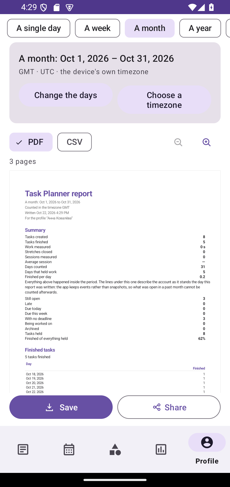
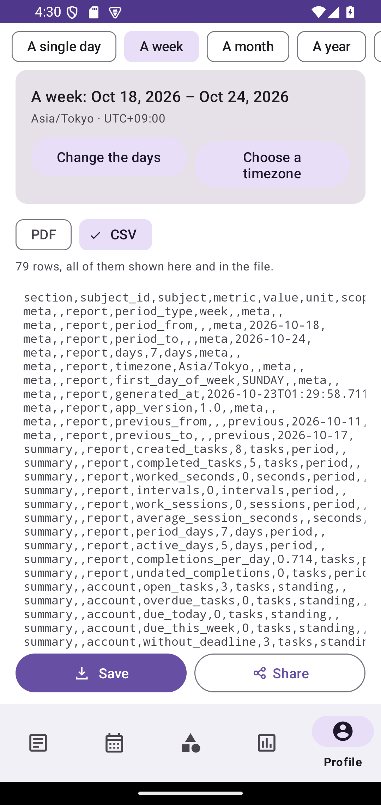
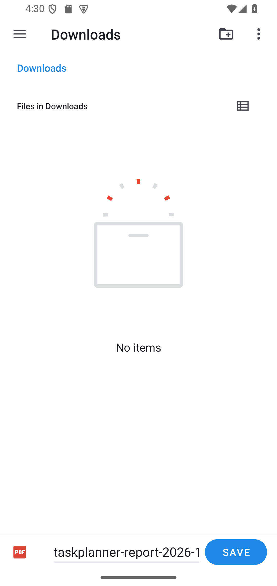
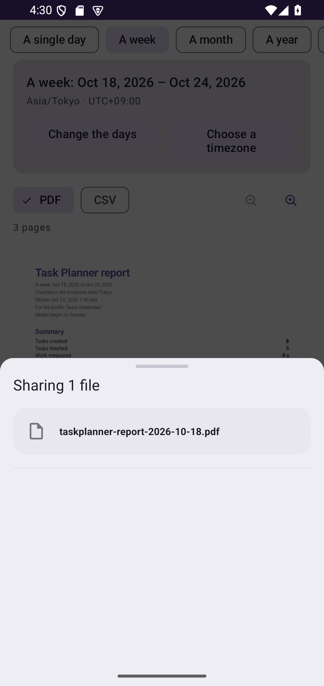
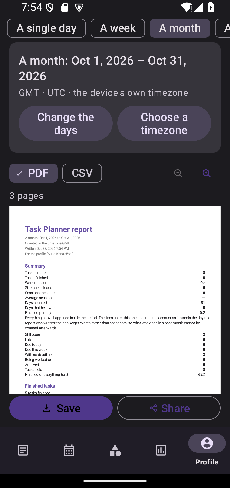

# Report export: the screen, the csv, the pages, and where a file goes

Stage 3J Parts 3 to 5 turn one `Report` into a screen a reader can use and into two files. The same figures
go into all three; only the sentences differ. Nothing here reads the database, and nothing here recomputes a
number — `ReportRepository` answered the ten sections once, and the screen and every file below are those
answers laid out.

```
ReportRepository  →  ReportLayout (sentences)   →  ReportPagination (pages)  →  PdfReport / PdfDocumentSurface
ReportRepository  →  CsvReport (rows)           →  ReportExportRepository     →  the picker's uri
                                                                            →  FileProvider + Sharesheet
```

The screen sits on top of both. `ReportViewModel` holds one state — the question, the report, its pages, the
file's rows, the two hand-over flags and the message to print — and `ReportFragment` renders it, with
`ReportPreviewView` drawing the very pages the pagination made and `CsvReport.lines(...)` stating the very
rows the writer wrote.

## The report screen

**Getting there.** Profile → Reports. It is a navigation destination like the other account screens, reached
from the profile card beside Settings, Goals, Habits and Insights.

**The question.** Five chips, and each is one of the five real `ReportPeriod` variants — a day, a week, a
month, a year, or a range of the reader's own. Changing the kind keeps the day being looked at rather than
jumping to the start of the new period, because a reader moving from a month to its days is asking about the
same week they were standing in. A range whose last day falls before its first is refused with a sentence and
the period does not move; the dialog that produced it stays open so the mistake can be corrected.

**The timezone.** The screen opens on the device's own zone and says so (`GMT · UTC · the device's own
timezone`). Choosing another opens a searchable list over `ZoneId.getAvailableZoneIds()` — several hundred
entries, so it is filtered rather than scrolled — where every row states the offset that zone is standing at
*today*, which is the difference between `Asia/Tokyo · UTC+09:00` and a name a reader cannot check. Choosing
one re-reads the same period through that zone, and the device's zone can be given back. A zone is never
replaced by a fixed offset: the boundaries and the day each row belongs to are computed by `java.time`, so a
period crossing a DST change is counted in the zone rather than in an hour difference.

**The answer, and what the screen does not do.** One immutable `ReportState` holds the question, the report,
its pages, the file's rows, the two hand-over flags and the message to print. The screen computes nothing: no
SQL, no counting of finished tasks, no sums, no goal progress, no habit streaks, no achievements, no
comparison, no chart rebuilt from the figures a preview draws, and no filling-in of a figure the report left
empty — an absent value stays absent and says so in the report's own words. The read runs on
`Dispatchers.Default` inside the repository; the layout and pagination run there too, through
`ReportExportRepository.pages(...)`, which is the same call the save makes, so the preview shows the document
rather than a screen's version of it.

**Two views of one document.** The PDF view draws the pages: `ReportPreviewView` measures the whole document
and paints only the band the reader can see, at three levels — a sheet fitted to the screen, then 1.5×, then
2.25× — inside a scroller that grows sideways when the reader asks for more. The csv view prints the file's
own lines, produced by `CsvReport.lines(...)` — the same serializer the writer uses — so a field holding a
comma or a line break reads exactly as it does in the file. A row stays one row: the block scrolls sideways
rather than folding a value in two, and the caption above it says either "79 rows, all of them shown here and
in the file" or "the first 120 of 151 rows are shown", because a preview that hides its own cut is a preview
that lies. The zoom goes with the sheets it acts on and is not offered over rows.

**Another account.** A profile switch puts the previous answer away *before* the new read starts, and an
answer that arrives for a question the screen no longer shows is dropped. A stale figure under a new profile
name is the failure this rule exists for: it looks correct.

**Saving.** The promise comes last. The reader presses Save, the platform's own `CreateDocument` sheet opens
with the name the exporter suggests, the reader chooses a place, the uri comes back, the stream is opened, the
bytes are written, the stream is closed, the exporter counts them, and only then does the screen say
"Written to the file you chose — 86 959 bytes." A sheet closed without choosing a place is silence rather than
an error. A location that will not open, a write that breaks partway, a file the device drew no bytes into,
and a report that is not there to write are four different sentences, none of them an exception's own text. No
storage permission is requested and no path is ever invented.

**Sharing.** Stage a copy under `cache/report_exports/`, point `FileProvider` at it, hand the intent to the
chooser — and leave the copy where it is, because a receiving app opens on its own schedule. The two failures
are two sentences: a copy that could not be written is not the same complaint as a copy this app's own
provider cannot point at.

**Coming back.** The screen re-reads when it returns to view, because what the reader did elsewhere belongs in
the report — but a refresh is not a new question, so the document already on screen stays there until the
newer one arrives, and the two hand-overs stay live through it. A refresh asked for while bytes are being
written waits for the next return rather than starting a second question over the report being saved.

**The cache.** `pruneStaged()` is called once, from `MainActivity` at start-up, off the main thread, and never
from a timer: the newest five staged exports are kept and older ones evicted. A sweep at start-up cannot
delete a file a recipient is still opening, and an idempotent sweep costs nothing on a screen the reader may
visit twenty times.

## The csv

One column set runs from the first row to the last, so the file can be filtered without a
parser that learns a new table shape per section.

| Column | What holds it |
| --- | --- |
| `section` | `meta`, `summary`, `completed_tasks`, `worked_time`, `categories`, `goals`, `habits`, `dynamics`, `achievements`, `comparison`, `findings` — §6's ten, in order, with a `meta` block in front |
| `subject_id` | The identity the app gives the row for exactly this purpose: a goal's or habit's `uuid`, an achievement's `rule key`. Empty for the report itself, for a day row, and for a category — a category is named, because its numeric row id means nothing on another device |
| `subject` | The name the reader gave it, verbatim |
| `metric` | `completed_tasks`, `worked_seconds`, `finished`, `marks`, `kept_percent`, `progress`, `reached`, `moved_in_period`, … |
| `value` | The figure, in the unit named by `unit`. Absent means empty, never `0` and never a dash |
| `unit` | The unit the figure is stated in: `tasks`, `seconds`, `days`, `sessions`, `intervals`, `percent`, `share`, `flag`, `version`, `grants`, `items`, `rows`, `weeks`, `days` for a habit run. An achievement row names what *its own rule* counted — `tasks`, `goals`, `projects`, `habits`, `marks`, `sessions`, `streak_days`, `active_days`, `hours`, `other` — because the unit is stored on the grant rather than looked up from the rule that made it |
| `scope` | `period` (what happened in the window), `standing` (what is true the day the report was written), `previous` (the comparison window), `meta` |
| `day` | `uuuu-MM-dd`, the local day the row is about, in the report's own zone. Empty when the row is not about a day |
| `text` | Prose that belongs to the row: a category name, an achievement's stored description, an insight's paragraph, a note that explains why a figure is missing |

**Encoding and separators.** UTF-8, written with the byte-order mark first — that is how Excel on
Windows decides the file is UTF-8 rather than its own code page, and without it a Russian
category name arrives as mojibake. Fields are separated by `,` or `;`: Excel takes its list
separator from the locale, and a locale that writes `3,14` expects `;` between fields, so
`CsvReport.defaultDelimiter()` follows that rule and the delimiter is also a parameter, for a
caller writing the file for a parser instead of for a spreadsheet.

**Numbers and dates.** `Locale.ROOT`, no grouping separators, a full stop as the decimal mark,
and a measured duration in whole seconds — the figure the database holds, not a rounded
"4 h". Dates are ISO-8601. A report's own day-by-day lines are therefore sortable by any tool
that reads them, and a `31 июня` cannot appear.

**Quoting.** RFC 4180: a field is wrapped in double quotes when it holds the delimiter, a quote,
a line break, or a carriage return, and every quote inside it is doubled. Rows end with `CRLF`
and the file ends with a line break. No field is ever concatenated into a row without passing
through `CsvReport.quote`, which is the only reason a task titled `Work, "urgent"` is one field
rather than three.

**Formula injection.** A stored string that begins with `=`, `+`, `-` or `@` — or with whitespace
hiding which of those is first — is prefixed with a single apostrophe, the marker Excel and
LibreOffice read as "this is text" and do not display. The rest of the field is untouched, so the
reader's own words are all still there. The marker is applied only to fields that came from
stored text; a figure this app printed (`-5`, `0.333`) is left alone, because a minus sign on a
number is arithmetic rather than a formula. This is a visible change to one character of one
field, and it is the smaller of the two distortions available: the other is a spreadsheet that
runs a formula from a task title.

**What is not in the file.** No profile id, no numeric row id, no `sync_state`, no tombstone
flag, no token, no Firebase uid. A report is a document about work, and the columns that exist
to move rows between this app's own copies are nobody else's business.

## The PDF

A4 portrait (595 × 842 pt), 44 pt side margins, and the app's own typographic scale narrowed
for print: a 22 pt title, 13.5 pt section headings, 10.5 pt body, 9.5 pt table text, 8.5 pt
captions. The colours are fixed for paper — the accent for headings and rules, the app's ink for
text, its grey for qualifications, the green of a finished task for finished work — and are read
from `report_*` colour resources, so the light theme and the dark theme print the same page.

Layout is decided in `ReportPagination`, not in the drawer:

* Text is wrapped by measurement through `ReportMeasurer`, so a heading in Cyrillic and a heading
  in Latin are asked the same question.
* A paragraph may end wherever the paper runs out. A heading, a label with its figure, a table
  row and a chart may not.
* A table that continues is given its column titles again on the next sheet, with the hairline
  under them. A flow's first group always carries its header; a later group carries it whenever
  it opens a page.
* A row taller than a whole sheet is sliced between its own lines rather than drawn past the
  bottom, and every line of it arrives somewhere on the following sheets.
* A chart given a short page gives up plot height first — `ChartGeometry` normalises against the
  tallest value, so a shorter plot is the same chart — and below 40 pt it keeps its words and
  drops the picture.
* Every page numbers itself (`3 / 7`); every page after the first carries the report's title as a
  running header, shortened with an ellipsis only if it cannot fit, which hides nothing because
  the title is printed in full on the first sheet.

Charts are built only from the report's own figures: the day-by-day work and completions as two
single-series bar charts (the same pair the dashboard puts beside each other), and the categories'
share of measured time as one proportion bar with its parts listed. A series with nothing in it
gets a sentence instead of a chart.

**Cyrillic and emoji.** Text is drawn in the named `sans-serif` family, whose glyphs the platform's
writer embeds into the file, so `Привет`, `ё` and `Ё` travel with the document. What "embeds" means was
measured rather than assumed: Android's `PdfDocument` — producer `Skia/PDF m128` on the API 35 emulator —
carries each used glyph as a `Type3` font program (`/Subtype /Type3` with a `/CharProcs` dictionary that draws
the outline) beside a `/ToUnicode` map that turns those outlines back into characters. There is **no
`/FontFile2`** in the file, so a check written for that one key reports "no embedded font" about a document
that does carry its own letterforms; `ReportPdfInspection` asks the general question instead, and reads the
file both raw and with its streams inflated, because the dictionaries sit inside them.
Emoji are drawn
from a separate colour font whose glyphs are bitmaps and cannot join a text layer, so a picture
in the reader's own title is marked `[?]` in the PDF, once per run, and the report's closing
section says that it was. The csv keeps the emoji exactly as typed.

## Where a file goes

**Saving.** `ActivityResultContracts.CreateDocument(mimeType)` opens the system picker, and the
uri it returns is opened with `contentResolver.openOutputStream(uri, "wt")` — the same shape the
backup export already uses. The stream is closed before the export is called saved, and the four
ways it can end are four different answers: `Saved(uri, bytes)`, `Cancelled`, and `Failed` with
`NO_PROFILE`, `LOCATION_UNWRITABLE`, `WRITE_INTERRUPTED` or `EMPTY_FILE`. No storage permission is
requested, and nothing is ever written to a path the app made up.

**Naming.** `taskplanner-report-<date>.<ext>` in ASCII: a day names its whole date, a month its
year and month, a year its year, a week the day it starts on, a chosen range both ends. The
period sorts a folder of exports into the order the periods ran.

**Sharing.** A share needs a copy the app can grant over, so a staged report lives in
`cache/report_exports/` and its uri is minted by `FileProvider` at the moment the intent is
built, with `FLAG_GRANT_READ_URI_PERMISSION` so the right lasts as long as the hand-over does. The
provider's configuration is one rule — that directory — and not a path to the app's files or to
the database. The copy is not deleted when the share is handed over: a recipient that has not
opened it yet would find nothing. The directory is capped instead — the newest five staged exports
are kept and older ones are evicted when a new one lands — and `pruneStaged()` offers the same
sweep to a caller that wants it at start-up, which arrives with the report screen. No age limit is
applied: a timer would delete a file somebody is still opening.

Handing a file to the Sharesheet is the end of what this app can see. It is a hand-over, not a
delivery, and no screen promises more than "the file was given to the app you chose".

## Measured cost, and what is not measured here

On the JVM (Robolectric, medians of seven runs, a 512 MB test heap):

| Report | blocks | sheets | draws | csv | layout | paging | csv write |
| --- | --- | --- | --- | --- | --- | --- | --- |
| one day | — | 1–2 | — | 3.3 KB | — | — | — |
| a year, 40 categories | 196 | 22 | 3 007 | 190 KB | 41 ms | 10 ms | 11 ms |
| the fullest account: 366 days, 300 categories, 120 goals, 120 habits, 25 grants, 60 findings | 316 | 37 | 5 260 | 411 KB | 86 ms | 33 ms | 25 ms |

The ceilings the tests assert are absolute: 500 ms per pass and 4 MB per file. No ratio between
two JVM timings is asserted anywhere, because that measures the scheduler rather than the code.

These numbers are the JVM's, not a handset's. The half that only a device can answer is the
drawing: `PdfDocument` writes into native memory, its pages are rasterised by the platform's own
text engine, and Robolectric's implementation accepts every drawing call and produces a file of no
bytes at all. `PdfReportInstrumentedTest` covers that half and is run on a device or an emulator —
CI compiles it and does not run it.

## Checked on an emulator, 22 October 2026

Both device suites were run on a full Android 15 emulator (API 35, x86_64, `swiftshader_indirect`, 1080×2280) —
a device, but not a physical handset. `am instrument` reported `OK (2 tests)` for the screen and its save, and
the PDF suite passed on the same image. What was looked at, and what it settled:

| Claim | What the run showed |
| --- | --- |
| The preview draws, it does not merely measure | Every screenshot carries a page of real text: the heading, the summary's two columns, the tables, the profile name in Cyrillic (`Анна Ковалёва`). A white rectangle would have passed a view-tree check and cannot pass a photograph. |
| A report fits the screen it is on | The sheet is measured against the scroller's width *minus that scroller's own padding*. Before the fix the right-hand column of figures ran under the margin and `62%` was cut in half; after it, the paper's own right margin is visible on every page. |
| A row of csv stays one row | With `scrollHorizontally`, the drawn line count equals the row count — asserted on the device, and visible in `06-csv-preview.png`. Before it, a long row folded mid-value and looked like two. |
| The zoom acts on the document | 1× → 1.5× → 2.25× measured to the pixel, the buttons letting go at both ends, and the round trip returning the sheet to the size it started at. |
| The picker is the platform's | `05-save-picker.png` is the system's own *Save to Downloads* sheet, carrying the name the exporter suggested and a PDF badge. Nothing was written, and the screen said nothing, because the reader backed out. |
| The Sharesheet is handed a real file | `07-share-sheet.png` reads "Sharing 1 file — taskplanner-report-2026-10-18.pdf", and the staged copy was still on disk afterwards. |
| A finished save writes what it promises | Pressing the platform's own SAVE put `taskplanner-report-2026-10.pdf` in Downloads. The screen announced *86 959 bytes*; the file pulled off over `adb` is **86 959 bytes**. The announcement is what the exporter counted on its way out, so the two agreeing is the end of §6's sequence. |
| Those bytes are a real PDF | `%PDF-1.4` header, `%%EOF` trailer, `/Count 3` matching the "3 pages" the screen showed, producer `Skia/PDF m128`, and — read through the inflated streams — 8 `Type3` fonts with `/CharProcs` and 8 `/ToUnicode` maps: the letterforms travel inside the file and its text is text. |
| The screen holds up in dark and at large text | Both device suites pass again with the system in night mode and with `font_scale` at 1.3; the photographs show the header wrapping rather than clipping, the sheet still paper-white on a dark screen, and the figures column still whole. |

The four photographs below are the ones that decided something; they are in `docs/images/reports/` so the
claims above can be looked at rather than taken on trust.

| | |
| --- | --- |
|  | `report-opened.png` — a month, three pages, the figures column whole and the paper's right margin visible. |
|  | `csv-rows.png` — a week's 79 rows, none of them folded, the zoom put away with the sheets. |
|  | `save-picker.png` — the system's *Save to Downloads*, opened by the app's Save and answered by nothing when the reader backed out. |
|  | `share-sheet.png` — "Sharing 1 file", named by `ReportNaming`, the copy left on disk behind it. |
|  | `report-night-large-font.png` — the same screen in dark and with large text: the header wraps, nothing clips, the sheet is still paper. |

The `/FontFile2` assertion Part 4 shipped with failed on this run, and the measurement above is why: it was the
wrong key rather than a missing font. `PdfReportInstrumentedTest` now asks the question the way
`ReportPdfInspection` states it.

## Still needs a physical handset

1. Choose a place to save on a manufacturer's Documents UI rather than the sample one, and confirm the file
   opens afterwards. The emulator ran AOSP's own picker; a vendor's is a different app with different rules
   about the same uri.
2. Open the exported PDF in a third-party viewer. The bytes above are the app's answer; how a second
   implementation reads `Type3` outlines is a question for that implementation.
3. Select text in the PDF and copy it in a real viewer: what comes out should be the report's own words. The
   `/ToUnicode` maps say the file allows it; only a viewer proves it works.
4. Share to another app and confirm the recipient opens it without this app holding any permission. The sheet
   and the surviving copy are photographed above; the receiving app was not.
5. Report a year with three hundred categories, print it, and look at the sheet where a table continues: the
   column titles should be there again, and no value should stop at the edge of the paper.
6. Save a title with an emoji in it, and confirm the PDF marks it `[?]` and the csv keeps the emoji.
7. Run it with a finger rather than with `am instrument`: the tests wait for the screen, which is not the
   same thing as a reader finding the screen quick enough to notice nothing happened.
